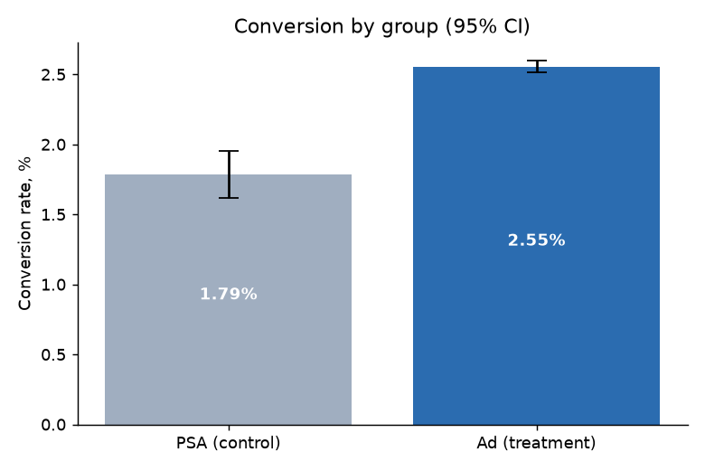
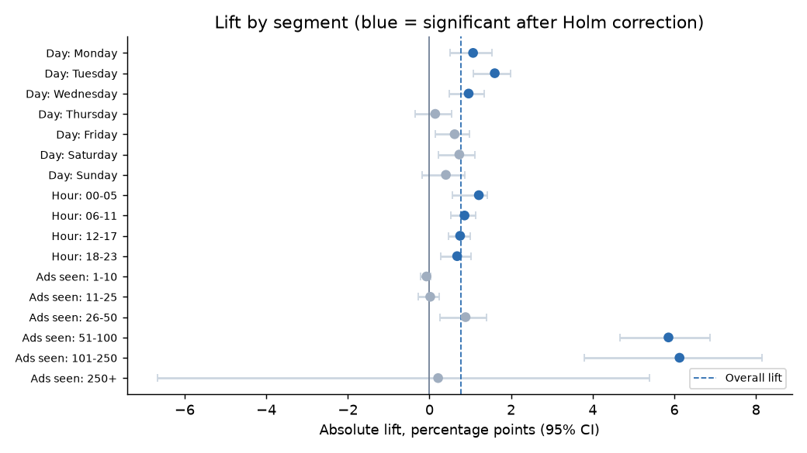
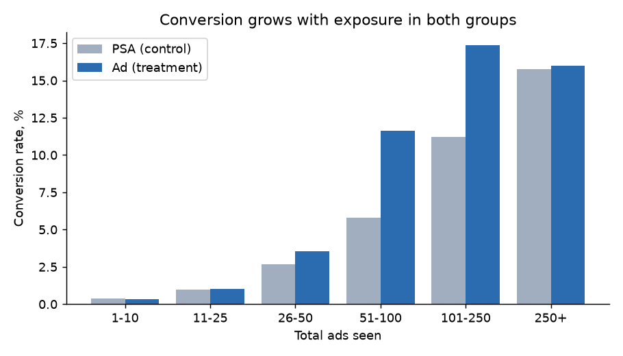

# Marketing A/B Test Analysis

Did showing users an **ad** instead of a **public service announcement (PSA)** increase conversion? This project analyzes a real marketing experiment with **588,101 users**, following the steps of a production A/B test review: check the data, check the randomization, measure the effect, test that it holds up, look at segments without fooling yourself, and turn the result into a decision.

**Data:** [Marketing A/B Testing](https://www.kaggle.com/datasets/faviovaz/marketing-ab-testing) (Kaggle). Each row is a user with their group (`ad` / `psa`), whether they converted, how many ads they saw, and the day and hour they saw the most ads.

## Result in one paragraph

Ads work. Conversion is **2.55% with ads vs. 1.79% with PSA**: **+0.77 percentage points (95% CI 0.59–0.94), +43% relative**, p < 0.001. That is about **4,300 extra conversions** in the ad group. The effect holds after adjusting for the groups' day, hour and exposure mix (odds ratio 1.48, 95% CI 1.33–1.64). It is concentrated in users who saw 26+ ads; the 73% of users who saw 25 or fewer show no measurable lift.



## 1. Data quality

| Check | Result |
|---|---|
| Rows / unique users | 588,101 / 588,101 |
| Duplicate users, users in both groups | 0 / 0 |
| Missing values | 0 |
| Groups | only `ad` and `psa` |
| `converted` | only 0 and 1 |
| `total_ads` | 1 to 2,065 (99th percentile: 202), long tail kept |

The data is clean, so nothing was removed.

## 2. Split and randomization

- **Split: 96% ad (564,577) / 4% PSA (23,524).** This is a deliberate design: most users see the ad and a small holdout sees the PSA. The planned ratio is not published, so a sample ratio mismatch (SRM) check against the plan is not possible.
- **The groups are not perfectly balanced.** The day of the week with most exposure differs by up to **2.6 pp** (Thursday: 14.0% of ad users vs. 16.6% of PSA users), the hour by up to 1.2 pp; both are significant (chi-square p < 0.001). The median number of ads seen is 13 vs. 12.
- These variables are measured *after* assignment (they describe when and how often each user saw the ad or PSA), so the gap may come from different delivery schedules for ads and PSAs rather than broken randomization. The data cannot tell which.
- **So I checked whether the imbalance changes the answer** (section 4). It does not.

## 3. Main result

| Metric | Value |
|---|---|
| Conversion, ad | 2.555% (14,423 of 564,577) |
| Conversion, PSA | 1.785% (420 of 23,524) |
| Absolute lift | **+0.77 pp**, 95% CI 0.59 to 0.94 (Newcombe) |
| Relative lift | **+43%**, bootstrap 95% CI +31% to +58% |
| p-value | 1.7 × 10⁻¹³ (two-proportion z-test; chi-square gives the same) |
| Extra conversions in the ad group | ≈ 4,343 (95% CI 3,316 to 5,284) |

## 4. Does it hold up?

| Estimate | Lift |
|---|---|
| Raw | odds ratio 1.44, +0.77 pp |
| Logistic regression with day, hour bucket and log(ads seen) | **odds ratio 1.48** (95% CI 1.33 to 1.64), p < 0.001 |
| Post-stratified by day × exposure, weighted to the ad group's mix | **+0.76 pp** |

The adjusted estimates match the raw one, so the day/hour/exposure imbalance does not explain the result.

## 5. Power and sample size

- **Achieved power** for the observed effect: ~100%. The test was more than large enough.
- **Minimum detectable effect** with this design (α = 0.05, power 80%): **+14% relative (+0.26 pp)**. Smaller effects could have been missed.
- **The 96/4 split is expensive.** To detect the observed effect, a 50/50 split needs **~11,200 users in total**; the 96/4 split needs **~72,800**, 6.5× more. A small holdout costs fewer lost conversions while the test runs, but needs much more traffic.

Users needed **per group** (50/50 split) to detect a relative lift at this baseline (1.79%):

| Relative lift | +5% | +10% | +20% | +30% | +50% |
|---|---|---|---|---|---|
| Users per group | 353,833 | 90,537 | 23,656 | 10,958 | 4,256 |

## 6. Segments, and how not to fool yourself



17 segments were tested (7 days, 4 hour buckets, 6 exposure buckets). With that many tests, about one false positive is expected by chance, so p-values were corrected with the **Holm** method:

- **12 segments are significant before correction, 9 after.** Friday, Saturday and the 26–50 ads bucket lose significance. Reporting "the ad works on Fridays" from raw p-values would be a mistake.
- Thursday shows no lift (+0.14 pp, p = 0.55). Note the low sample per day in the control group (~3,000 users), so a real but smaller effect could be hidden.

**Exposure is where the effect lives, but read it carefully:**



| Ads seen | Share of users | Share of conversions | Lift |
|---|---|---|---|
| 1–10 | 44.3% | 5.8% | none (−0.07 pp, n.s.) |
| 11–25 | 28.8% | 11.6% | none (+0.02 pp, n.s.) |
| 26–50 | 15.1% | 21.1% | +0.88 pp (n.s. after Holm) |
| 51–100 | 7.8% | 35.3% | **+5.9 pp** |
| 101–250 | 3.3% | 22.4% | **+6.1 pp** |
| 250+ | 0.6% | 3.9% | none (+0.2 pp, very wide CI) |

- Conversion grows with exposure **in the PSA group too** (0.4% → 15.8%), even though a PSA does not sell anything. More engaged users both see more ads and convert more. So "more ads → more conversions" is **not** a causal conclusion from this data.
- What the data does show: the ad's extra effect over the PSA appears only for users with roughly 50–250 exposures. For the 73% of users with 25 or fewer, the ad performs like a PSA.

## 7. Recommendation

1. **Keep the ad campaign.** It lifts conversion by about 43% with high confidence.
2. **Test frequency directly.** The effect seems to need repeated exposure, but exposure was not randomized. A follow-up test that randomizes frequency caps (for example 10 / 25 / 50 ads per user) would show whether more ads cause more conversions or only reach more engaged users.
3. **For the next test, use a larger control group** (for example 80/20 or 50/50) or plan the sample size up front with the table above. The 4% holdout needed a very large audience.
4. **Missing for a full business case:** ad costs (to calculate CAC and ROAS of the incremental conversions) and timestamps (to check novelty effects and that nobody stopped the test early after peeking).

## Project structure

```
src/analyze.py      data checks, balance checks, main test, adjusted models, power, segments, charts
report/             charts, CSV tables, findings.json with every number used in this README
```

## How to run

```bash
python -m venv .venv
.venv/Scripts/pip install -r requirements.txt   # .venv/bin/pip on macOS/Linux
curl -L -o data/marketing_AB.csv.gz https://github.com/jszymon/uplift_sklearn_data/releases/download/marketing_AB/marketing_AB.csv.gz
.venv/Scripts/python src/analyze.py
```

The data file is a gzip copy of the Kaggle dataset, mirrored by the [uplift_sklearn_data](https://github.com/jszymon/uplift_sklearn_data) project. It is not committed to this repository.
